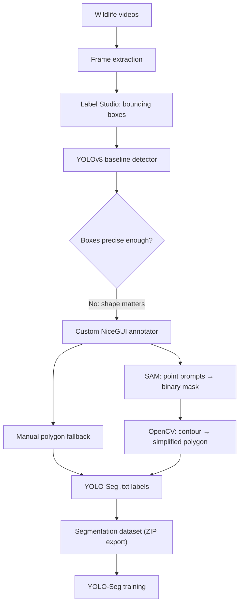

# 🐍 Serpentra: Snake Detection & Instance Segmentation

An end-to-end computer-vision pipeline for detecting snakes in difficult wildlife footage, evolving from bounding-box detection to **pixel-level instance segmentation**, including a custom web-based annotation tool that uses the Segment Anything Model (SAM) to accelerate labeling.

> **Topics:** `computer-vision` `yolo` `instance-segmentation` `segment-anything` `opencv` `nicegui` `pytorch` `dataset-engineering`

---

## Why this project exists

Snakes are hard targets: long, thin, coiled, camouflaged, and often partly hidden by vegetation. A rectangular bounding box around a snake contains mostly background, so it says little about the animal's actual shape. This project started with detection as a baseline, then moved to segmentation once the limits of boxes were clear.

## Pipeline



## Key components

### 1. Baseline detection
- Fine-tuned a pretrained Ultralytics **YOLOv8n** model (transfer learning) on box annotations.
- Training configuration: 100 epochs, `imgsz=1280` (to preserve thin-object detail), batch 16, `lr0=0.001`, early-stopping patience 10, dual-GPU training (`device=[0,1]`).

### 2. SAM-assisted annotation tool (NiceGUI)
- **Interactive prompting:** left-click = positive point, right-click = negative point; SAM returns a candidate mask that the annotator reviews and corrects.
- **Manual polygon fallback** for low-contrast, heavily occluded, or camouflaged cases where the model output isn't trustworthy.
- **Multi-annotator task pool:** images are claimed and locked so two annotators never work on the same frame; claims expire after a 10-minute inactivity timeout so abandoned tasks return to the pool.
- **Responsive UI:** SAM inference runs in a dedicated single-worker `ThreadPoolExecutor` so heavy computation doesn't freeze the interface.
- **Dataset export:** images and labels are streamed into a ZIP in memory (no permanent intermediate file).

### 3. Mask → YOLO polygon conversion
```
SAM binary mask → cv2.findContours (RETR_EXTERNAL) → cv2.approxPolyDP (simplify)
→ quality filters → normalise coordinates by image width/height
→ "<class_id> x1 y1 x2 y2 ... xn yn"
```
Quality filters reject contours with area < 20 px or fewer than 3 vertices, which removes noise and invalid polygons before they reach the training set.

### 4. Ecosystem exploration
Evaluated MegaDetector as a coarse animal-filtering stage, Roboflow Universe for supplementary data, and multiple Ultralytics YOLO generations for detection and segmentation.

## My contribution

> **[Confirm and edit]**: I worked on the full pipeline described above: dataset preparation, YOLO baseline training, SAM-assisted annotation tooling, contour/polygon processing, YOLO-Seg label generation, and GPU training.
> *Add: team size, which parts you built personally, and the time period.*

## Results

| Metric | Value |
|---|---|
| Dataset size (images / annotated instances) | **[ADD]** |
| Detection baseline (mAP50) | **[ADD]** |
| Segmentation model (mask mAP50) | **[ADD]** |
| Annotation speed-up vs. manual polygons | **[ADD only if measured]** |

*Only list numbers you can reproduce from your logs.*

## Tech stack
Python · PyTorch · CUDA · Ultralytics YOLO · Segment Anything (SAM) · OpenCV · NiceGUI · Label Studio

## Repository layout *(adjust to match your files)*
```
├── annotator/        # NiceGUI app, SAM wrapper, polygon conversion
├── training/         # YOLO / YOLO-Seg training scripts + dataset YAML
├── docs/             # diagrams, screenshots
└── README.md
```

## Limitations & next steps
- SAM masks still need human review in camouflage and heavy-occlusion cases.
- Dataset variety (lighting, species, backgrounds) bounds generalisation.
- Next: temporal tracking across frames, evaluation on held-out field footage.

## Data & licensing
*State the source and license of your footage and any Roboflow data. Don't commit raw footage you don't have rights to share.*
